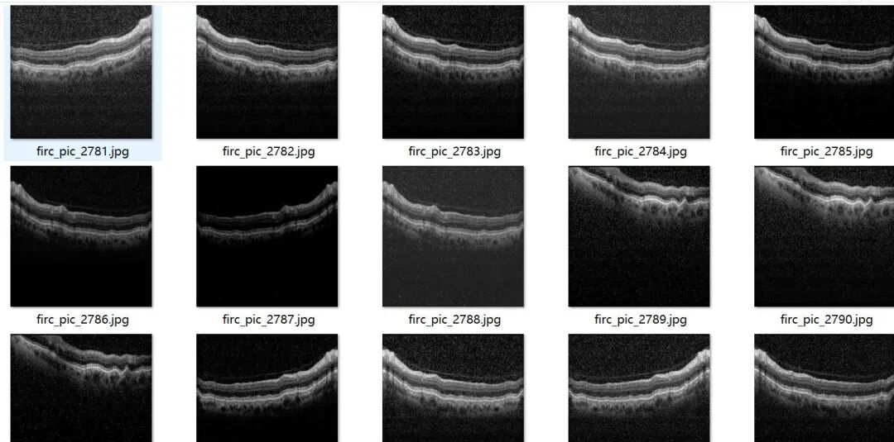
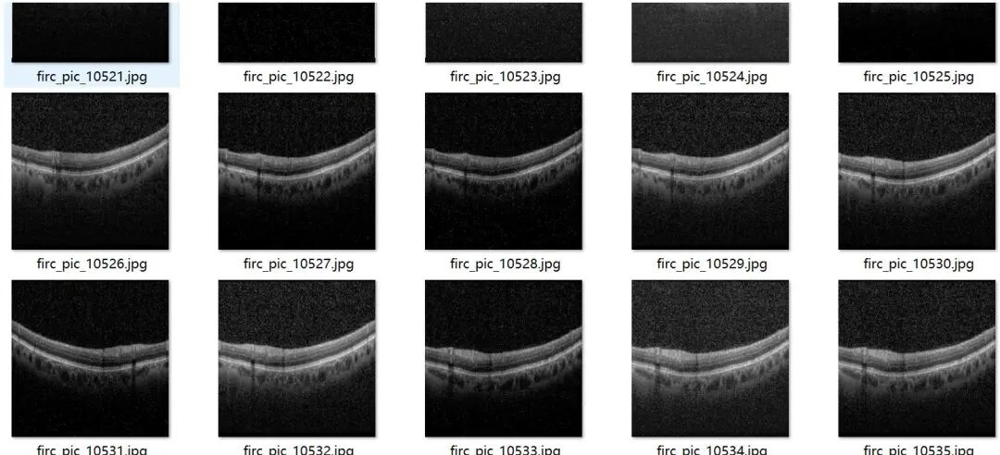
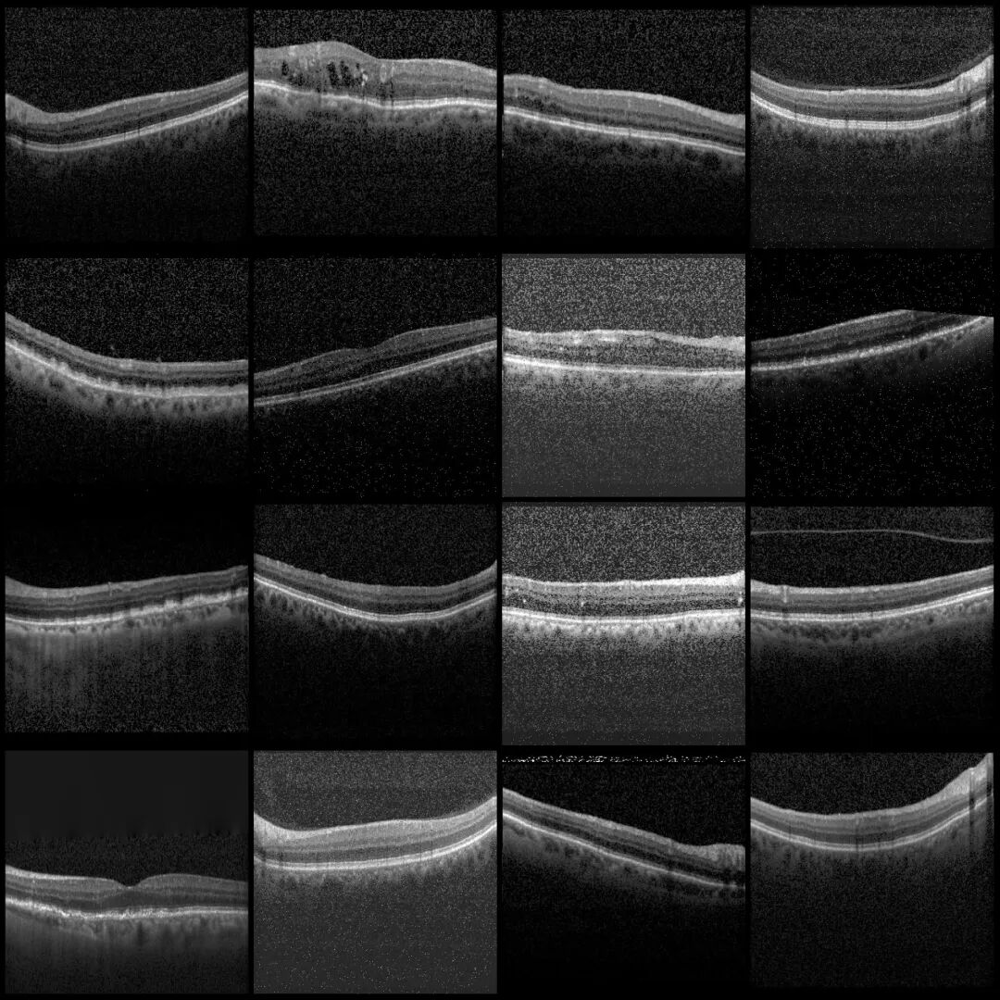
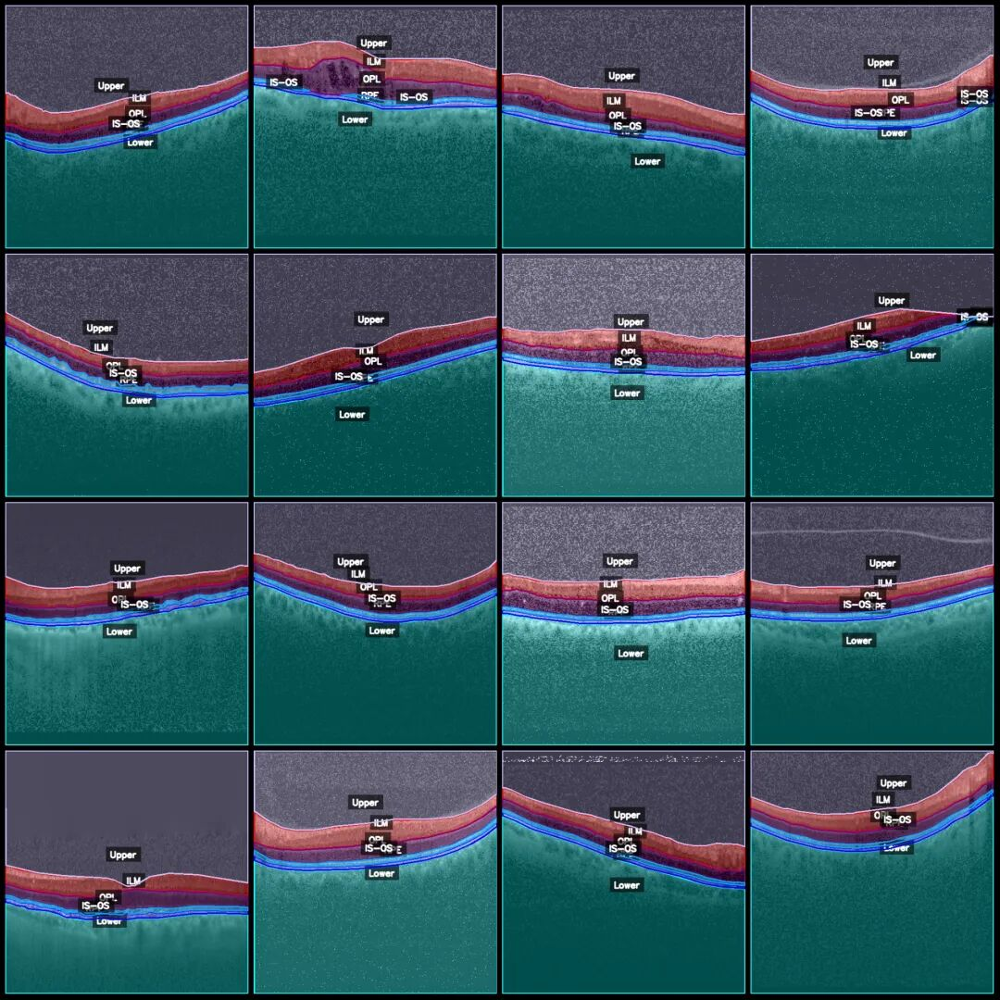
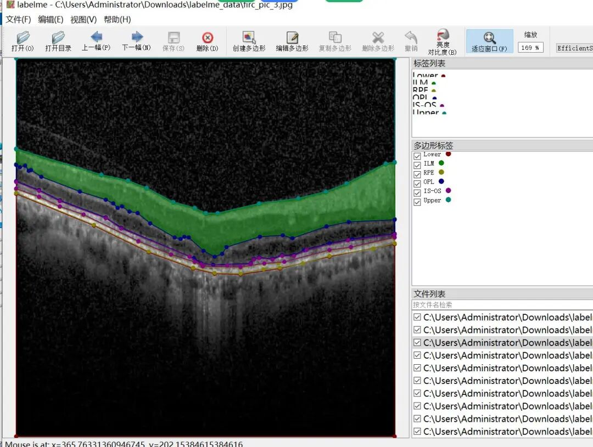

# Smart Medical Optical Coherence Tomography (OCT) Retinal Image Segmentation Dataset in LabelMe format with 12,948 images across 6 categories with enhanced features.

Please note that approximately 4500 in the dataset are original images with noise added to enhance them, enhanced by a factor of 1:2. The enhancement is achieved through the addition of different noise densities. Please be aware that the images may not be very clear; please refer to the image preview for details.

Dataset format: labelme format (without mask files, only including jpg images and corresponding json files)

Number of images (number of jpg files): 12948

Number of annotations (json file count): 12948

Label count: 6

Label category names: ["ILM", "IS-OS", "Lower", "OPL", "RPE", "Upper"]

Number of boxes labeled in each category:

ILM (Inner Layer Membrane) count = 13309

IS-OS (Photoreceptor inner segment/outer segment) count = 17501

Lower (lower region) count = 12948

OPL (outer parasitic layer) count = 13346

RPE (Retinal Pigment Epithelium) count = 13829

Upper (upper region) count = 12953

Total frames: 83886

Using labeling tool: labelme=5.5.0

Image resolution: 512x512

Annotation rules: Draw polygons around the categories.

Important Notice: The dataset can be opened and edited using LabelMe. For JSON datasets, one must convert them into mask or Yolo formats for semantic segmentation or instance segmentation.

Special : This dataset does not guarantee the accuracy of the trained models or weight files.

Image Preview:

Annotation example:

Original image (pick 16 randomly):

Annotation:

LabelMe editing example:

## Payment

Here is a pay link on Stripe ( https://buy.stripe.com/3cs8yP7sY87d0vu9AB ). Please contact me lonlonago@foxmail.com after funding $89, and I will send you a complete data files , thank you!

